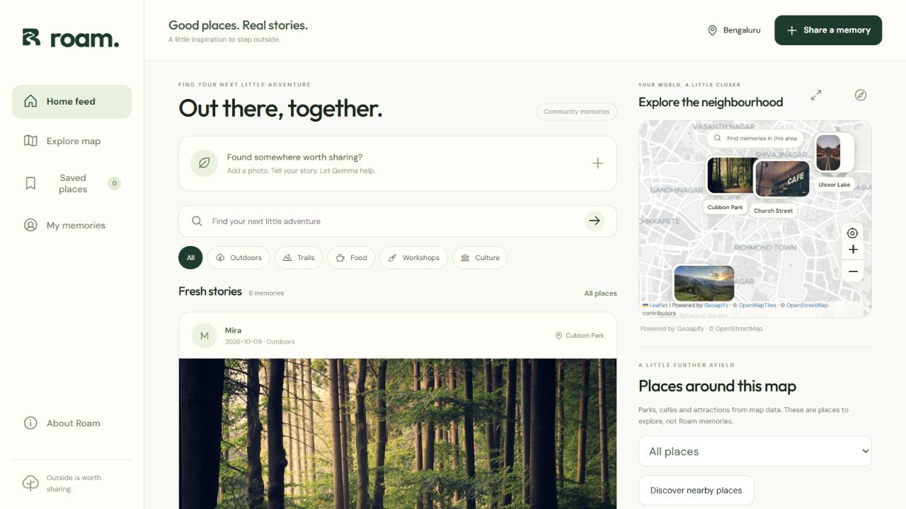
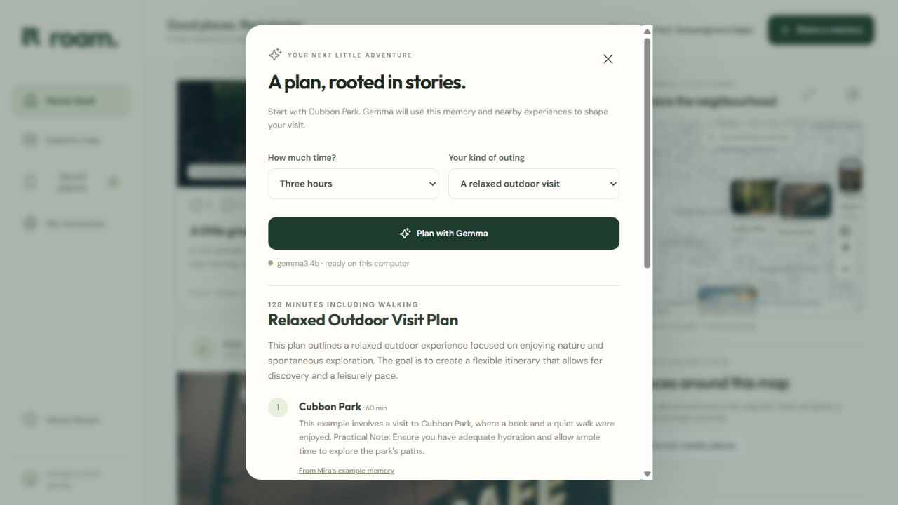

# Roam — places worth remembering

Anonymous place memories with a photo-rich social feed, an adjacent discovery map, and local Gemma assistance. Trail R is the selected brand direction. The application lives at `/`; its separate landing page is `/welcome`.

## Challenge submission

Built during the Hacktoberfest Week 1 Touch Grass window (5–11 October 2026 PDT; closes 12 October at 12:29 IST). This clean source snapshot was published before the deadline; it excludes private operational history, credentials and user data. Any later changes must be identified as post-deadline work.

**Live preview:** https://roam-bitshank.onrender.com — browsing/discovery only. Public posting is disabled; the hosted preview has no connected Gemma GPU. The full AI workflow runs locally with Ollama.

## Run locally

Requires Node 24.14+ and Ollama. Run `npm ci`, `ollama pull gemma3:4b`, then `npm start`. Open http://127.0.0.1:4180. Gemma runs through local Ollama. No Render credits or paid inference key are required for this local build. Model weights are not bundled. The supplied Windows launcher starts Node and Ollama in the background.

## Current implementation

- Responsive desktop photo feed with a map alongside it; mobile Feed, Explore map, Saved, Share and My memories navigation. Photo pins, place details, categories, text search and map-area filtering. The expanded view reuses the discovery map; posting creates its picker on demand.
- Real heart counts, one heart per browser/post, moderated replies, browser-local saves and share links. No signup, followers or direct messages.
- Server-issued random private browser keys restore contribution ownership. Recovery includes browser identity, legacy editing keys and saved memories. Keep recovery files private. Clearing browser storage without recovery loses ownership; there is no hardware fingerprinting.
- Photos/text only for new contributions. Up to 15 MB per JPG/PNG/WebP photo; decoded, resized, metadata-stripped and re-encoded as WebP. New video uploads are disabled.
- Voice composer with transcript review and Gemma-assisted field filling. Browser recognition can require its provider's online service. Typed input remains available. Place candidates require confirmation; unknown date/duration stay blank. Text drafts survive reload; media must be reattached.
- Short experience notes expand into 4–8 lines. Original short notes remain verbatim. Gemma selects checked fact IDs from an exact-title or confirmed-redirect Wikipedia reference with a matching supplied city; code attaches exact source text. Without a suitable reference, expansion uses labelled visit guidance instead of invented facts. Durable signed provenance protects source metadata through publication and recovery.
- Listen uses matching local device voices, short chunks, Stop and cancellation on navigation, editing or page hiding. Missing voices produce an explicit error. Voice availability varies by device.
- Gemma place summaries and visit plans use approved post IDs and enforced stop/time budgets. Fictional examples are labelled and kept separate from real contributions in plans and trends. Memories are not live opening hours, prices or upcoming workshop listings.
- Durable Checking, Needs review, Blocked and Published states. New photos remain in private quarantine. Unavailable, malformed or ambiguous moderation cannot publish. Edits retain the previous approved snapshot while the replacement is checked. Protected operator page: `/moderator`; its key is in `DATA_DIR/moderator-key.txt` or `ROAM_MODERATOR_KEY`.
- Persisted Trending on Roam refreshes at 06:00 Asia/Kolkata and catches up once after restart. Ranking uses recency-weighted approved non-demo memories from seven days, one browser/place/day and duplicate filtering. A place needs three eligible memories from at least two browser identities; otherwise the module says Recently shared. Gemma explains ranked places using actual source IDs and cannot reorder them. Removed/blocked content immediately invalidates affected snapshots.

## Setup still required

**Geoapify:** map tiles, search, nearby places and walking routes are integrated using one private backend key. See [setup, interfaces and usage controls](docs/geoapify.md). The local `.env` is loaded when the server is started normally. Geoapify takes precedence over optional Google configuration; OSM tiles are the fallback on provider failure. Wikipedia grounding remains independent.

**Automatic policy screening:** Access to both Hugging Face models is granted and private download authentication is configured outside the repository. Weights are still absent and the inspected Python runtime has no CUDA support. New posts/replies stay private for operator review. [Screening setup and validation](docs/shieldgemma.md) covers the sidecar and evaluation required before automatic approval. Gemma context assistance cannot replace dedicated classifiers.

**Figma:** the [editable draft](https://www.figma.com/design/I0yQCFd9jHNqdbK8mG5QsG) contains tokens, components and desktop/mobile product screens. Some text/row layouts require repair. MCP quota prevented final repairs and the browser editor requires sign-in. Repair scripts and a status ledger are in workspace outputs. The draft is not a completed fidelity deliverable.

## Configuration and data

Environment: `PORT` (4180), `HOST` (127.0.0.1), `DATA_DIR` (data/), `OLLAMA_URL` (http://127.0.0.1:11434), `GEMMA_MODEL` (gemma3:4b), `GEOAPIFY_API_KEY`, `SEED_DEMOS` (0 disables examples for an empty database), `GOOGLE_MAPS_API_KEY`, `GOOGLE_MAPS_MAP_ID`, `ROAM_MODERATOR_KEY`, `SHIELDGEMMA_URL`, `SHIELDGEMMA_SERVICE_KEY`, `SHIELDGEMMA_VALIDATED` (enable only after evaluation). The main server loads its local `.env`; explicit process variables take precedence. Never commit real credentials.

SQLite remains the local default. Setting `DATABASE_URL` selects the asynchronous PostgreSQL backend with transactional ownership/moderation and a persistent geographic budget. Setting `S3_BUCKET` selects private S3-compatible media storage; the application continues to authorize every public and private photo request. Back up the whole data directory together, including database, uploads/quarantine and provenance signing key. Keep private keys and user data out of source archives. Public code uses plain JavaScript/CSS with self-hosted fonts.

Tiles, geocoding, illustrative Unsplash photos and Wikipedia need internet. Geoapify receives requested map areas, searches, nearby-map centers and public plan-stop coordinates through the backend; Google/Nominatim receive requests only when their fallback configuration is used; Wikipedia receives place/city queries, not the complete transcript or private GPS fix. Posting requires a recent browser location receipt and a confirmed public pin. A receipt is a client claim, not proof of attendance. The server does not retain the current GPS fix; it stores the chosen pin.

## Verification

`npm run check` checks syntax; `npm test` runs 54 tests covering source provenance/fact selection, speech sequencing/cancellation, ownership/recovery, private moderation/media states, reactions/comments, location receipts, trend ranking/grounding and restart catch-up. UI checks cover desktop/mobile feed and map, real heart toggling, private pending replies and Listen/Stop transitions. Real local Gemma summary smoke testing passed. The user confirmed audible summary playback and working microphone capture on the intended device on 12 October 2026. Optional live Google credentials and real ShieldGemma evaluation remain unverified. Geoapify is the selected map provider. Live Geoapify search, nearby discovery, PNG tiles and walking routes passed. A real Gemma example plan included a 23-minute walk and displayed its route on the map. Verification used an isolated 4183 preview with clearly labelled examples. The original 4180 service was restarted with the verified code after a private backup; existing memory counts were preserved.

## Hosting

A Free Render preview is deployed in Singapore. Tiger Data PostgreSQL is connected and its usage/trend records survived redeployment. Contribution mutations remain disabled until private photo storage is connected. A stable moderator key and `ROAM_PROVENANCE_KEY` are required before enabling production publishing. Free hosting sleeps, so trends catch up when the process wakes. The private GPU connection uses authenticated server-side URLs/keys. See [hosting and migration](docs/hosting.md). Before public launch, configure durable abuse limits, storage quotas, operational backups, retention/privacy rules and moderation staffing. Never expose unauthenticated Ollama publicly.

## Credits

Leaflet, OpenStreetMap/Nominatim, Phosphor icons, illustrative Unsplash photos, Google Fonts (Outfit and DM Sans, OFL), Ollama and Google's Gemma/ShieldGemma under their terms. Trail R imagery uses built-in imagegen. MIT covers source, not third-party media/map data/model weights. Submission materials identify the implemented local workflow separately from cloud services awaiting connection.

## Deployment preparation and checks

`npm run test:postgres` runs the full suite against the isolated PostgreSQL application backend. `npm run test:postgres:s3` also uses private MinIO media. `npm run test:pg-contract` exercises async store recovery/moderation contracts; `npm run test:storage` exercises migration, private media and persisted trends. These runners accept only the named disposable local test database, never Tiger Data production credentials. See [verification record](docs/verification.md) for results and remaining acceptance checks.

`compose.test.yaml` defines disposable PostgreSQL and source-built MinIO. MinIO's official community repository is archived/source-only, so its image is built from the pinned official source for local tests; it is not a production storage recommendation. On Windows this verification used an isolated WSL Docker engine because Docker Desktop was unavailable.

Use `ops/backup-data.py` for a checksum-verified SQLite/media backup and restore into a new directory. `ops/migrate-storage.mjs` preserves IDs and ownership when transferring into an empty PostgreSQL/private S3 destination. `ops/ai-gateway.mjs` provides the authenticated, bounded loopback gateway for a future HTTPS GPU service. Never commit real secrets, user photos, recovery files or labelled moderation evaluation material.

## Post-deadline demo supplement — 12 October 2026

The narrated 97-second video, player page, poster and transcript were added after the Week 1 cutoff (12 October 2026, 12:29 IST). These are supplementary presentation assets, not features completed before the deadline. The original DEV submission was published at 12:06:07 IST. No new prize category is claimed for this late addition.

[Watch the narrated demo](https://roam-bitshank.onrender.com/demo.html). Narration uses ElevenLabs Hope. The video edits actual captured local UI screens, with fictional examples and illustrative photos labelled. It distinguishes local Gemma capabilities from the read-only hosted preview and pending GPU/media connections.
